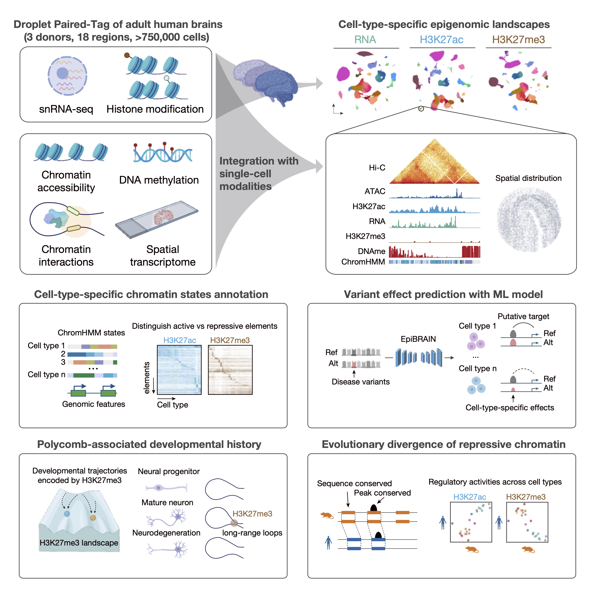

# MiniAtlas 
MiniAtlas is a single-nucleus, multi-omic atlas profiling transcriptome + histone modification in adult human brain.

🥃 This repository contains code to reproduce the analysis for our manuscript: **[Single-Cell Atlas of Transcription and Chromatin States Reveals Regulatory Programs in the Human Brain](https://pubmed.ncbi.nlm.nih.gov/41676679/)**
  

## Abstract
Understanding how cell-type-specific regulatory programs are established and maintained in the human brain requires direct measurement of chromatin states alongside transcription. Here, we present a large-scale single-cell multimodal atlas of the adult human brain generated by jointly profiling transcriptomes with active (H3K27ac) and repressive (H3K27me3) histone modifications. Across 18 brain regions, we profile over 750,000 nuclei spanning 160 cell types and integrate these data with single-cell chromatin accessibility, DNA methylation, genome architecture, and spatial transcriptomic datasets. This integrated framework enables functional annotation of over 500,000 candidate cis-regulatory elements, distinguishing accessible, active, and Polycomb-repressed states with cell-type and regional specificity. We further link enhancers to target genes, infer active or repressive gene regulatory networks in a cell-type-resolved manner, and functionally annotate chromatin loops, revealing neuron-enriched super long-range repressive interactions that preferentially engage developmental genes. By coupling these regulatory maps with genetic association data and sequence-based modeling, we prioritize noncoding variants, nominate their effector genes and vulnerable cell types across neuropsychiatric disorders. Cross-species integration further reveals an evolutionary asymmetry in regulatory grammar, with active programs broadly conserved and repressive programs more divergent. Together, this resource establishes a functional reference for the human brain regulatory architecture, providing a framework for interpreting noncoding genetic variants, understanding epigenetic memory, and linking chromatin states to brain structure and disease.

## Method
We used Droplet Paired-Tag to jointly profile the nuclear transcriptome together with either H3K27ac or H3K27me3 in the same nucleus.
- Protocol: [Droplet Paired-Tag v2.0](https://www.protocols.io/view/droplet-paired-tag-v2-0-kq5tcvy6p) (protocols.io)
- Original method: [Xie et al., *Nat Struct Mol Biol* 2023](https://www.nature.com/articles/s41594-023-01060-1)

## Data
- Raw data: NCBI Gene Expression Omnibus (GEO), accession [GSE327101](https://www.ncbi.nlm.nih.gov/geo/query/acc.cgi?acc=GSE327101)
- Processed data (interactive browser): https://miniatlas.nygenome.org/

## Repository structure
- `01.pre_process/`: barcode filtering and library QC
- `02.analysis/`: notebooks to reproduce the analyses and figures (see `02.analysis/README.md`)
- `bin/`: pipeline scripts and helper functions (see `bin/README.md`)

## Citation
Xie Y, Chang L, Zhong G, Rink JA, *et al.*, Ren B. Single-Cell Atlas of Transcription and Chromatin States Reveals Regulatory Programs in the Human Brain. *bioRxiv* (2026). doi: [10.64898/2026.02.02.703166](https://doi.org/10.64898/2026.02.02.703166). PMID: [41676679](https://pubmed.ncbi.nlm.nih.gov/41676679/)
